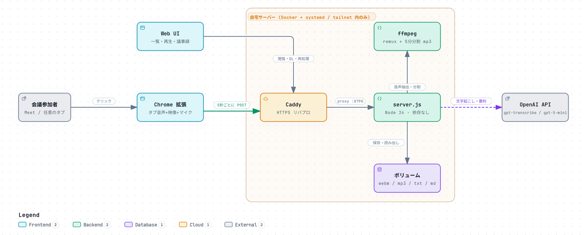
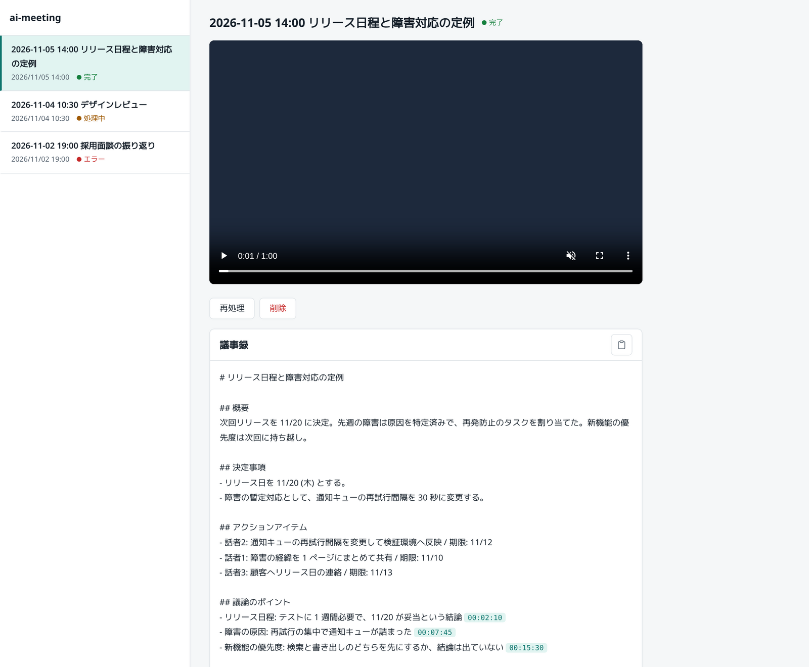

# ai-meeting

ブラウザで開いているオンライン会議 (Google Meet、Zoom の Web 版、Teams の Web 版など) を Chrome 拡張で録画し、自分のサーバーで文字起こし・議事録を作る。会議に Bot は入らない。
配信は tailnet 内だけ (例: `https://ai-meeting.example.com`、Caddy 経由)。
**このサーバーに認証はありません。公開インターネットには出さないこと。**



議事録の画面 (サンプルの録画)。文字起こしの時刻を押すと、動画がその位置へ飛ぶ。議事録は「Markdown をコピー」でクリップボードに入る。



- 拡張が 5 秒ごとに webm を送る。server.js は ffmpeg で音声を取り出し、pyannote の話者分離 (Community-1、CPU) で発話ごとに切って、OpenAI で文字起こし ($0.0045/分、gpt-transcribe) する。文字起こしは `[hh:mm:ss] 話者N: …` の形になる。議事録とタイトルは gpt-5.6-terra で生成する。
- 保存先は `~/ai-meeting/volume/<id>/` (recording.webm / transcript.txt / minutes.md)。
- Web UI (`/`) は一覧・再生・議事録・再処理・削除。文字起こしの `[hh:mm:ss]` をクリックすると動画がその位置へ飛ぶ。

Node 側は依存パッケージなし (Node 24 の fetch / FormData / node:test)。コンテナに ffmpeg と、話者分離用の Python (CPU 版 torch + pyannote.audio) を入れる。

話者分離は音声の長さの 0.8 倍ほどの時間がかかる (12 コアの CPU で 40 分の会議が約 32 分)。議事録は処理が終わってから出る。

## 常駐

docker compose ([compose.yaml](compose.yaml)) を systemd の user unit から起動する。

```sh
cp .env.example .env            # OPENAI_API_KEY と HF_TOKEN を入れる
mkdir -p ~/ai-meeting/volume ~/.config/systemd/user
ln -s "$PWD/ai-meeting.service" ~/.config/systemd/user/ai-meeting.service
systemctl --user daemon-reload
systemctl --user enable --now ai-meeting
```

- `HF_TOKEN` は話者分離のモデルを取るのに使う。[pyannote/speaker-diarization-community-1](https://huggingface.co/pyannote/speaker-diarization-community-1) のページで利用条件に同意し、read 権限のトークンを作る。モデルは初回に `~/ai-meeting/volume/hf/` へ保存される。
- 参加人数が分かっているなら `.env` の `NUM_SPEAKERS` に書くと精度が上がる。省略すると自動で数える。
- `ai-meeting.service` の `WorkingDirectory` は、この作業コピーの置き場に合わせて書き換える。
- 出すのは `127.0.0.1:8790` だけ。認証は無いので Caddy より外に出さない。
- 状態: `systemctl --user status ai-meeting` / `journalctl --user -u ai-meeting -f`
- `.env` を変えたら `systemctl --user restart ai-meeting`

Caddy には、`/etc/caddy/Caddyfile` の自分のドメインのブロック内に次を追加し、`sudo systemctl reload caddy` で反映する。

```
	@ai-meeting host ai-meeting.example.com
	handle @ai-meeting {
		reverse_proxy 127.0.0.1:8790
	}
```

## Chrome 拡張

1. Web UI の「extension.zip をダウンロード」(`/extension.zip`) を展開し、`chrome://extensions` → デベロッパーモード → 「パッケージ化されていない拡張機能を読み込む」で `extension` フォルダを選ぶ (この作業コピーの [extension/](extension) を直接選んでもよい)。
2. 会議のタブで拡張のアイコンを押す → 録画ページが別タブで開く (マイク許可を求められる)。
3. サーバー URL (初回のみ入力。以後は記憶) を確認して「録画を開始」。録画ページは閉じない。タイトルは「作成日時 + 内容から LLM が付けた短い題」になる。
4. 「停止して送信」で終了。会議タブを閉じても止まる。数分後に Web UI に議事録が出る。

- 録るのは、アイコンを押したタブに描画されている映像 (画面共有含む) と、そのタブの音声 + 自分のマイクを混ぜた 1 トラック。Meet 専用の処理はなく、音の出るタブなら何でも録れる。
- 録れないもの: Zoom や Teams のデスクトップアプリ、Chrome 以外のブラウザ (未検証)。
- 録画中も相手の声は自分のスピーカーから聞こえる (AudioContext で流し直している)。
- 録画には参加者への告知・同意が要る。音声は OpenAI へ送る。

## UI

画面の作りは [docs/ui-rules.md](docs/ui-rules.md) に従う。フレームワークは使わず、素の HTML / CSS / JS で書いている。

## 手元で動かす

```sh
OPENAI_API_KEY=... node server.js   # http://localhost:8790 、data/ に保存。ffmpeg と pyannote.audio が要る
node --test
```

## やっていないこと

- 話者の名前付け。「話者1」「話者2」のまま出す。
- 自分の声の別トラック送信。
- 無音境界での分割。発話の切れ目で分けるが、1 人が 5 分を超えて話し続けると途中で割れる。
